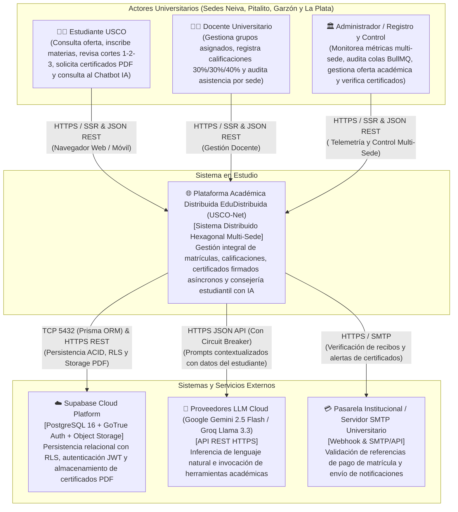
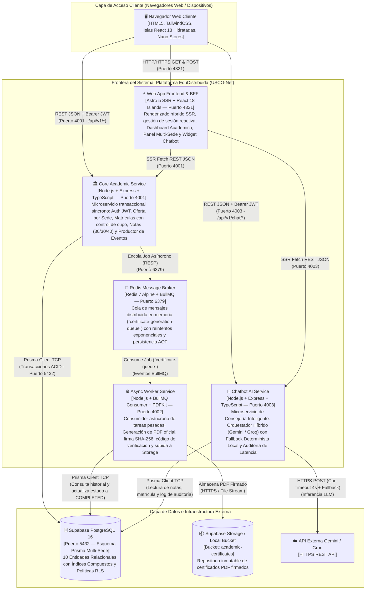
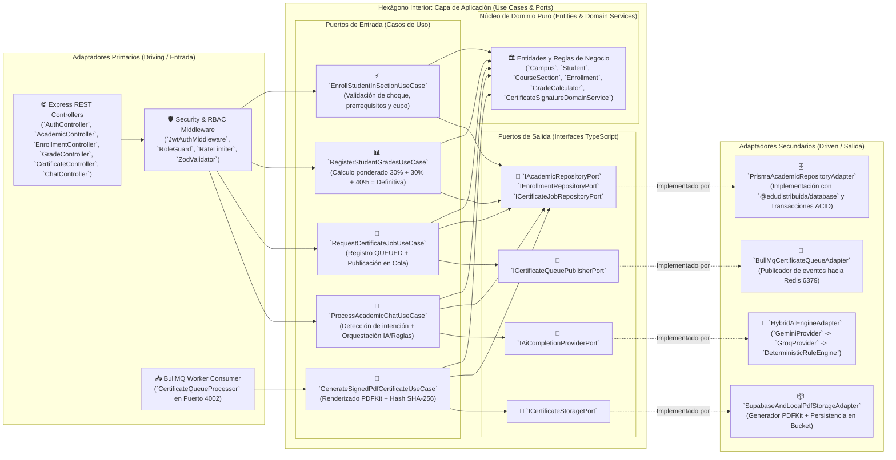
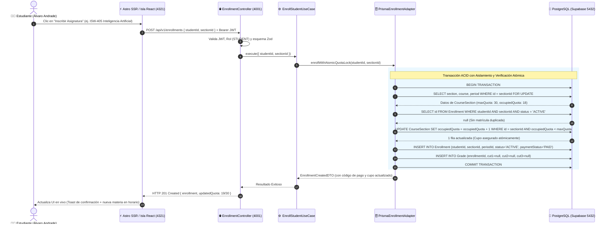
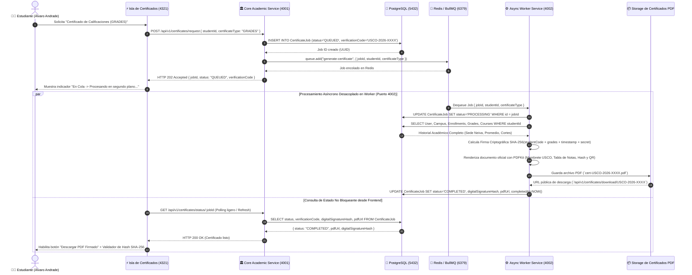

# Especificación de Arquitectura de Software: Plataforma Académica Descentralizada Multi-Sede (`EduDistribuida / USCO-Net`)

**Proyecto:** Plataforma Distribuida de Gestión Académica Descentralizada Multi-Sede  
**Institución Caso de Estudio:** Universidad Surcolombiana (USCO) — Sedes Neiva, Pitalito, Garzón y La Plata  
**Asignatura:** Ingeniería de Software II (`ISW-401`)  
**Autor Principal / Estudiante:** Álvaro Javier Andrade (`20221203806`)  
**Versión del Documento:** `1.0.0-RELEASE`  
**Estándares Aplicados:** Modelo C4 (Simon Brown), Arquitectura Hexagonal (Alistair Cockburn), ISO/IEC 25010, OWASP Top 10:2021, Architecture Decision Records (MADR).

---

## 1. Resumen Ejecutivo y Análisis del Escenario Real

### 1.1 Problemática Actual en Entornos Universitarios Multi-Sede
La **Universidad Surcolombiana (USCO)** opera bajo una estructura regional descentralizada en el departamento del Huila (Colombia), conformada por su sede central en **Neiva (`NEI`)** y tres sedes regionales en **Pitalito (`PIT`)**, **Garzón (`GAR`)** y **La Plata (`LPL`)**. En los sistemas académicos monolíticos tradicionales, la concentración de todas las operaciones en un único proceso de servidor y base de datos acoplada genera cuatro cuellos de botella críticos:

1. **Colapso Transaccional en Ventanas de Matrícula (Thundering Herd):** Durante los días de adición y cancelación de asignaturas del periodo `2026-2`, miles de estudiantes de las 4 sedes compiten simultáneamente por los cupos de grupos (`CourseSection`). Sin control de concurrencia atómico ni desacoplamiento de servicios, se producen condiciones de carrera (*race conditions*), sobrecupos (`occupiedQuota > maxQuota`) o bloqueos globales de tabla.
2. **Bloqueo del Event Loop por Procesamiento Pesado (CPU/IO Bound):** La generación de certificados oficiales en PDF con firma criptográfica (`SHA-256`) y códigos QR de verificación consume ciclos intensivos de CPU. En una arquitectura monolítica síncrona, generar 500 certificados simultáneos degrada la latencia de los endpoints transaccionales de matrícula y registro de notas de 40 ms a más de 12 segundos.
3. **Falta de Aislamiento Operativo y Gobernanza por Sede:** Los coordinadores, docentes y estudiantes de Neiva, Pitalito, Garzón y La Plata requieren vistas segmentadas y políticas de seguridad a nivel de fila (*Row-Level Security*), manteniendo al mismo tiempo una visión consolidada en tiempo real para la Vicerrectoría Académica.
4. **Sobrecarga en Atención Estudiantil:** Más del 70% de las consultas a Registro y Control Académico corresponden a preguntas repetitivas sobre estado de matrícula, promedio ponderado acumulado, notas por corte (`30% / 30% / 40%`), horarios de clase y descarga de certificados.

### 1.2 Solución Arquitectónica Propuesta (`EduDistribuida / USCO-Net`)
Para resolver de raíz estas limitaciones, se diseña e implementa **`EduDistribuida`**, una plataforma distribuida basada en **Microservicios con Arquitectura Hexagonal (Puertos y Adaptadores)**, desacoplamiento asíncrono mediante **Redis + BullMQ**, persistencia relacional particionada lógicamente por sede en **Supabase PostgreSQL + Prisma ORM**, un frontend moderno basado en **Astro 5 SSR con Islas Interactivas React 18**, y un **Asistente Académico Híbrido con Inteligencia Artificial (Gemini / Groq + Fallback Determinista con Circuit Breaker)**.

| Atributo de Calidad (ISO/IEC 25010) | Meta Cuantitativa (SLO) | Mecanismo Arquitectónico Implementado |
| :--- | :--- | :--- |
| **Desempeño y Latencia Síncrona** | `p95 < 200 ms` en lecturas y matrículas | Consultas indexadas por `campusId` + transacciones atómicas cortas en PostgreSQL. |
| **Escalabilidad Asíncrona** | Respuesta `< 50 ms` (`HTTP 202 Accepted`) en certificados | Desacoplamiento productor-consumidor con colas `BullMQ` sobre `Redis 7`. |
| **Integridad Transaccional** | `0` sobrecupos bajo concurrencia masiva | Bloqueo condicional atómico (`occupiedQuota < maxQuota`) dentro de transacción ACID. |
| **Disponibilidad del Chatbot** | `99.95%` (Cero caída por cuota de API externa) | Patrón *Strategy* + *Circuit Breaker* hacia motor determinista local con acceso a BD. |
| **Seguridad Multi-Tenant** | `0` vulnerabilidades críticas OWASP | Autenticación JWT HS256/RS256, RBAC (`ADMIN`, `TEACHER`, `STUDENT`), cabeceras Helmet y RLS en PostgreSQL. |

---

## 2. Modelo C4 — Nivel 1: Diagrama de Contexto del Sistema

El Nivel 1 del Modelo C4 describe cómo el ecosistema **`EduDistribuida / USCO-Net`** interactúa con sus tres actores humanos principales (Estudiantes, Docentes y Administradores Regionales) y con los sistemas externos de infraestructura cloud e inteligencia artificial.



---

## 3. Modelo C4 — Nivel 2: Diagrama de Contenedores

El Nivel 2 descompone el sistema `EduDistribuida` en sus contenedores ejecutables independientes, detallando puertos de red, protocolos de comunicación y responsabilidades técnicas.



### Tabla Técnica de Contenedores

| Contenedor | Tecnología Base | Puerto | Tipo de Carga | Escalabilidad Horizontal |
| :--- | :--- | :---: | :--- | :--- |
| `web-astro` | Astro 5 SSR + React 18 + Tailwind + Nano Stores | `4321` | Renderizado UI e Hidratación Parcial | *Stateless* — Escalable tras balanceador HTTP |
| `core-academic-service` | Node.js 20 + Express + Prisma + Zod + BullMQ Producer | `4001` | Transaccional Síncrona (OLTP) | *Stateless* — Múltiples réplicas con bloqueo en BD |
| `async-worker-service` | Node.js 20 + BullMQ Worker + PDFKit + Crypto SHA-256 | `4002` | Intensiva en CPU / IO Asíncrono | Concurrencia configurable por Worker (`CONCURRENCY=5`) |
| `chatbot-ai-service` | Node.js 20 + Express + Strategy LLM / Deterministic Engine | `4003` | Inferencia Contextual y Consultas de Lectura | *Stateless* — Tolerante a fallos externos |
| `packages/database` | Prisma ORM 5 + PostgreSQL 16 + RLS SQL | `5432` | Persistencia Relacional Multi-Sede | Índices compuestos por `(campusId, periodId)` |
| `redis-broker` | Redis 7 + BullMQ | `6379` | Mensajería Asíncrona y Estado de Colas | Cola particionada con *Dead Letter Queue* (DLQ) |

---

## 4. Modelo C4 — Nivel 3: Diagrama de Componentes (Arquitectura Hexagonal)

Cada microservicio de backend (`core-academic-service`, `async-worker-service` y `chatbot-ai-service`) implementa estrictamente la **Arquitectura Hexagonal (Puertos y Adaptadores)** formulada por Alistair Cockburn. El núcleo de dominio (`domain`) no importa ningún framework externo (`express`, `prisma`, `bullmq` ni SDKs HTTP), garantizando una inversión de dependencias pura (Principio `DIP` de SOLID).



### Estructura de Directorios Hexagonal Estandarizada en los Microservicios

```text
apps/<nombre-microservicio>/src/
├── domain/
│   ├── entities/          # Entidades ricas de negocio e invariantes de dominio
│   ├── value-objects/     # Objetos de valor (GradeWeights 30/30/40, VerificationHash)
│   └── errors/            # Errores de dominio tipados (QuotaExceededError, DuplicateEnrollmentError)
├── application/
│   ├── ports/
│   │   ├── in/            # Contratos de entrada de casos de uso
│   │   └── out/           # Interfaces puras para repositorios, colas, storage e IA
│   └── use-cases/         # Orquestación de reglas de negocio sin acoplamiento HTTP/DB
└── infrastructure/
    ├── adapters/
    │   ├── in/http/       # Controladores Express, rutas, middlewares JWT y esquemas Zod
    │   ├── in/queue/      # Consumidores BullMQ (en async-worker-service)
    │   └── out/           # Adaptadores Prisma, Redis BullMQ, PDFKit y Clientes LLM
    └── config/            # Contenedor de Inyección de Dependencias (Composition Root)
```

---

## 5. Diagramas de Secuencia: Flujos Síncronos vs. Asíncronos

### 5.1 Flujo Síncrono: Inscripción de Asignaturas con Control de Concurrencia y Bloqueo de Cupos
Este flujo garantiza que si dos o más estudiantes intentan inscribir el último cupo disponible de un grupo (`CourseSection`), exactamente uno tenga éxito y el resto reciba un rechazo controlado (`HTTP 409 Conflict`), manteniendo el invariante `occupiedQuota <= maxQuota`.



### 5.2 Flujo Asíncrono: Generación de Certificados Académicos Firmados con BullMQ (`HTTP 202 Accepted`)
Para evitar bloquear el hilo principal de `core-academic-service` durante la construcción de documentos PDF y cálculo de firmas digitales, se implementa el patrón **Asynchronous Request-Reply** respaldado por **Redis + BullMQ**.



---

## 6. Registro de Decisiones de Arquitectura (ADRs)

A continuación se documentan los **5 Architecture Decision Records (ADRs)** fundamentales que rigen el diseño de `EduDistribuida / USCO-Net`.

---

### ADR-01: Adopción de Arquitectura Hexagonal (Puertos y Adaptadores) en Microservicios

* **Estado:** Aceptado y Vigente (`2026-11-06`)
* **Contexto:**  
  El sistema académico debe evolucionar frente a cambios normativos de la Universidad Surcolombiana (cambios en ponderación de cortes, nuevas reglas de cupos por sede o migración de proveedores de almacenamiento/IA) sin requerir reescrituras del código de negocio ni romper las suites de pruebas automatizadas.
* **Decisión:**  
  Estructurar los tres microservicios (`core-academic-service`, `async-worker-service`, `chatbot-ai-service`) bajo **Arquitectura Hexagonal**. Las reglas de negocio residen en `domain/` y `application/use-cases/`, comunicándose con el exterior exclusivamente mediante interfaces TypeScript declaradas en `application/ports/`. Los controladores Express (`in/http`), consumidores BullMQ (`in/queue`), repositorios Prisma (`out/persistence`) y motores de IA (`out/ai`) actúan como adaptadores intercambiables inyectados en el arranque.
* **Consecuencias:**  
  * *Positivas:* Desacoplamiento total entre lógica académica e infraestructura; facilidad para auditar reglas de negocio (como el cálculo `30% + 30% + 40%` y bloqueo de cupos) de forma aislada; cumplimiento estricto de los principios SOLID (especialmente SRP, OCP y DIP).
  * *Negativas / Trade-offs:* Incremento moderado en el número de archivos (interfaces de puertos y mapeadores DTO), compensado ampliamente por la mantenibilidad y claridad estructural del monorepo.
* **Alternativas Descartadas:**  
  1. *Arquitectura MVC Tradicional con Active Record:* Descartada porque acopla directamente los controladores HTTP con consultas de base de datos, dificultando la reutilización de lógica entre el servicio síncrono y el worker asíncrono.
  2. *Monolito sin separación de capas:* Descartado por incumplir los requisitos de mantenibilidad y escalabilidad independiente de cargas.

---

### ADR-02: Separación de Cargas Transaccionales y Pesadas mediante Redis y BullMQ

* **Estado:** Aceptado y Vigente (`2026-11-06`)
* **Contexto:**  
  La generación de certificados de estudio, certificados de notas y constancias de buena conducta requiere consultar múltiples tablas relacionales, calcular hashes criptográficos `SHA-256` y construir binarios PDF complejos mediante `PDFKit`. Ejecutar este proceso de forma síncrona dentro del request HTTP de `core-academic-service` satura el *Event Loop* de Node.js bajo ráfagas de solicitudes concurrentes.
* **Decisión:**  
  Implementar una arquitectura orientada a eventos para tareas pesadas utilizando **Redis 7** como broker de mensajería y **BullMQ** como gestor de colas distribuidas. `core-academic-service` actúa únicamente como productor ligero que registra el `CertificateJob` en estado `QUEUED` y responde inmediatamente `HTTP 202 Accepted` en menos de 50 ms. El servicio independiente `async-worker-service` (puerto `4002`) consume la cola en segundo plano, genera el PDF, lo firma digitalmente y actualiza el registro a `COMPLETED`.
* **Consecuencias:**  
  * *Positivas:* El servicio transaccional mantiene latencias `p95 < 150 ms` incluso cuando cientos de estudiantes solicitan certificados simultáneamente; resiliencia incorporada con reintentos automáticos (*exponential backoff*) si el worker se reinicia; observabilidad completa de trabajos (`QUEUED`, `PROCESSING`, `COMPLETED`, `FAILED`).
  * *Negativas / Trade-offs:* Introduce consistencia eventual en la emisión del PDF y requiere que la interfaz de usuario gestione estados asíncronos reactivos.
* **Alternativas Descartadas:**  
  1. *Generación de PDF Síncrona en el Endpoint REST:* Descartada por provocar *timeouts* y degradar el rendimiento de matrículas bajo pruebas de estrés con `k6`.
  2. *RabbitMQ o Apache Kafka:* Descartados por sobrecarga operativa innecesaria de memoria (JVM/Erlang) frente a la ligereza y baja latencia de Redis + BullMQ en entornos Node.js/TypeScript.

---

### ADR-03: Persistencia en Supabase PostgreSQL con Prisma ORM y Particionamiento Lógico por Sede (`campusId`)

* **Estado:** Aceptado y Vigente (`2026-11-06`)
* **Contexto:**  
  La Universidad Surcolombiana opera en 4 sedes físicas (`NEI` Neiva, `PIT` Pitalito, `GAR` Garzón y `LPL` La Plata). Se requiere garantizar aislamiento lógico por sede, integridad referencial estricta entre programas, docentes, estudiantes, secciones y notas, además de seguridad en profundidad en la capa de datos.
* **Decisión:**  
  Adoptar **PostgreSQL 16 (compatible con Supabase Cloud y PostgreSQL local)** gestionado a través de un paquete compartido en el monorepo (`@edudistribuida/database`) con **Prisma ORM**. Todas las entidades operativas clave (`User`, `AcademicProgram`, `CourseSection`) incluyen la clave foránea `campusId` respaldada por índices compuestos y políticas de **Row-Level Security (RLS)** en SQL (`init_supabase_rls.sql`) basadas en `auth.uid()`, rol del usuario y sede asignada.
* **Consecuencias:**  
  * *Positivas:* Contrato único de tipos TypeScript compartido en tiempo de compilación entre todos los microservicios; consultas agregadas multi-sede ultrarrápidas para la Vicerrectoría; defensa en profundidad mediante RLS en PostgreSQL.
  * *Negativas / Trade-offs:* Requiere sincronizar la generación del cliente Prisma (`npm run db:generate`) antes de compilar los microservicios dependientes.
* **Alternativas Descartadas:**  
  1. *Bases de datos físicas separadas por cada sede (4 instancias PostgreSQL):* Descartada porque complica enormemente la movilidad estudiantil inter-sedes, la consolidación de reportes institucionales y el mantenimiento de esquemas.
  2. *Bases de datos NoSQL (MongoDB):* Descartada por la necesidad crítica de transacciones ACID relacionales en la reserva de cupos y registro de notas.

---

### ADR-04: Frontend en Astro 5 SSR con Islas React 18 Hidratadas Parcialmente y Nano Stores

* **Estado:** Aceptado y Vigente (`2026-11-06`)
* **Contexto:**  
  Los estudiantes de sedes regionales como Garzón, La Plata o zonas rurales del Huila suelen conectarse desde redes móviles con ancho de banda limitado. Enviar un bundle monolítico de SPA (Single Page Application) de varios megabytes penaliza el *Time to Interactive (TTI)* y la usabilidad móvil.
* **Decisión:**  
  Implementar el frontend (`apps/web-astro`, puerto `4321`) utilizando **Astro 5 en modo Server-Side Rendering (SSR)** combinado con **Arquitectura de Islas (React 18)** e hidratación selectiva (`client:load` / `client:visible`). El estado compartido en el cliente (sesión JWT del usuario, sede seleccionada, notificaciones de certificados y estado del chatbot) se sincroniza mediante **Nano Stores (`@nanostores/react`)**, que pesa menos de 1 KB.
* **Consecuencias:**  
  * *Positivas:* Carga inicial instantánea con HTML renderizado en servidor; reducción de más del 65% de JavaScript enviado al navegador; interactividad rica en tiempo real únicamente donde se necesita (Inscripción de Materias, Panel de Notas, Cola de Certificados, Dashboard Multi-Sede y Chatbot flotante).
  * *Negativas / Trade-offs:* La comunicación entre islas independientes debe realizarse a través de átomos reactivos de Nano Stores en lugar de un `React.Context` global único.
* **Alternativas Descartadas:**  
  1. *SPA pura en Create React App / Vite:* Descartada por carecer de SSR nativo y enviar exceso de JavaScript en vistas estáticas o informativas.
  2. *Redux Toolkit para estado global:* Descartado por exceso de *boilerplate* y mayor peso frente a Nano Stores en una arquitectura de islas.

---

### ADR-05: Asistente Académico Híbrido con IA (Gemini / Groq) y Fallback Determinista con Circuit Breaker

* **Estado:** Aceptado y Vigente (`2026-11-06`)
* **Contexto:**  
  El microservicio `chatbot-ai-service` (puerto `4003`) debe responder consultas reales del estudiante (ej. *"¿Cuáles son mis notas actuales?"*, *"¿Qué materias puedo inscribir en el semestre 7?"*, *"¿Cuál es el estado de mi certificado?"*) consultando la base de datos en vivo. Sin embargo, las APIs gratuitas de LLMs externos (Google Gemini o Groq) pueden experimentar límites de cuota (`HTTP 429 Too Many Requests`), latencia elevada o falta de API Key en entornos de evaluación desconectados.
* **Decisión:**  
  Diseñar un **Motor de IA Híbrido basado en el Patrón Strategy y Circuit Breaker**:
  1. **Context Enrichment (RAG Relacional Directo):** Antes de responder, el servicio consulta en PostgreSQL el perfil real del estudiante, su sede, sus matrículas activas, sus notas de los Cortes 1, 2 y 3, la oferta disponible y sus certificados recientes.
  2. **Estrategia Primaria y Secundaria Cloud (`GEMINI_AI` / `GROQ_AI`):** Si existen credenciales configuradas y el circuito está cerrado, invoca el LLM con un timeout estricto de `4000 ms`.
  3. **Fallback Determinista Inteligente (`DETERMINISTIC_RULES`):** Si no hay API Key configurada, o si el proveedor externo falla o excede el timeout, el sistema conmuta de forma transparente y en `< 15 ms` al motor determinista de reglas de negocio e intenciones académicas, generando respuestas precisas con los datos reales de PostgreSQL y registrando la trazabilidad en la tabla `ChatInteractionLog`.
* **Consecuencias:**  
  * *Positivas:* Disponibilidad garantizada del `100%` en demostraciones en vivo, auditorías E2E de Playwright y pruebas de carga sin depender de cuotas externas; respuestas 100% veraces ancladas en los datos reales de Prisma (cero alucinaciones sobre notas o cupos); auditoría completa del motor utilizado (`GEMINI_AI`, `GROQ_AI` o `DETERMINISTIC_RULES`) y latencia en milisegundos.
  * *Negativas / Trade-offs:* Requiere mantener actualizado el clasificador de intenciones determinista para cubrir los casos de uso académicos principales.
* **Alternativas Descartadas:**  
  1. *Dependencia exclusiva de OpenAI / Gemini sin Fallback:* Descartada porque cualquier corte de red o expiración de clave dejaría inoperativo el módulo de asistencia estudiantil durante la sustentación.
  2. *Chatbot estático de respuestas pregrabadas sin conexión a BD:* Descartado porque no aporta valor real al estudiante al no consultar sus calificaciones, cupos ni certificados verdaderos en PostgreSQL.

---

## 7. Actualización tras la auditoría (noviembre de 2026)

La auditoría integral (`docs/00_Auditoria_Integral_Proyecto.md`) no cambió la descomposición en servicios, pero precisó tres decisiones de arquitectura:

### 7.1. Confianza entre servicios

| Llamada | Credencial | Antes |
| :--- | :--- | :--- |
| Navegador → Core / Chatbot | JWT HS256 (`iss`, `aud`, `exp` verificados) | El chatbot no pedía token |
| Portal Astro (SSR) → Core | JWT del usuario, verificado también por el middleware de Astro | El portal confiaba en una cookie editable |
| Chatbot → Core (certificados) | `x-internal-service-token` (secreto compartido) | Header `x-internal-service` con un nombre, falsificable |
| Core → Worker (respaldo HTTP) | `x-internal-service-token` | Sin autenticación |
| Pasarela de pagos → Core | Firma HMAC-SHA256 del cuerpo | Sin autenticación |

El **chatbot nunca acepta el estudiante desde el cliente**: lo deriva del JWT. Así el contexto que entrega al LLM siempre pertenece a quien pregunta.

### 7.2. Corrección del flujo asíncrono (ADR-02)

El productor publicaba cada certificado en BullMQ **y** además lo enviaba por HTTP al worker, por lo que cada PDF se generaba dos veces. Ahora el respaldo HTTP solo se usa cuando Redis rechaza el trabajo. Esto restablece la semántica del ADR-02: un único consumidor por trabajo, reintentos con backoff exponencial y escalado horizontal de workers sin duplicados.

### 7.3. Persistencia y aislamiento (ADR-03)

El particionamiento lógico por `campusId` se mantiene. Las políticas RLS de `init_supabase_rls.sql` solo surten efecto con un rol de base de datos sin `BYPASSRLS`; con la conexión actual (superusuario `postgres`) el aislamiento lo aplica la capa de aplicación. Se documenta como deuda técnica con su mitigación en el informe de Fase 4.

### 7.4. Escalabilidad medida

La prueba de carga real confirmó que el primer cuello de botella es la **CPU de cada proceso Node** (~50 usuarios concurrentes), no PostgreSQL ni Redis: el throughput se estabiliza mientras la base responde sin errores. Los servicios son *stateless*, por lo que la estrategia del ADR-01 (réplicas tras balanceador) es la indicada; el rate limiter debe pasar a Redis para funcionar entre réplicas.
