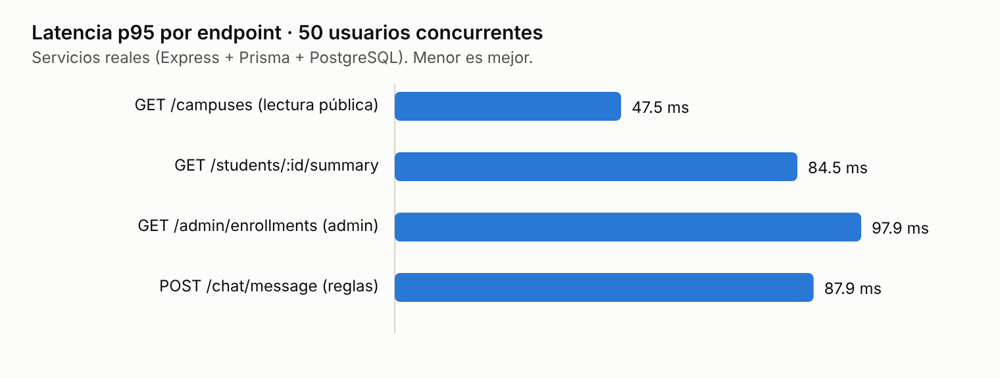
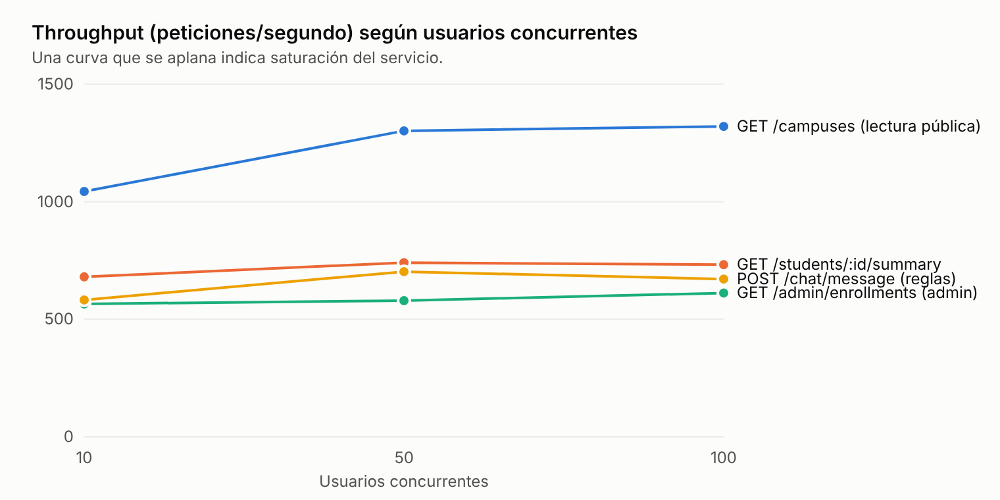

# 04. Informe de aseguramiento de calidad: rendimiento, seguridad y usabilidad

**Proyecto:** EduDistribuida / USCO-Net — Universidad Surcolombiana (sedes Neiva, Pitalito, Garzón y La Plata)
**Fase 4 del enunciado:** someter el sistema a auditorías de rendimiento (carga y estrés), seguridad (OWASP Top 10) y usabilidad (evaluación heurística).
**Entregable:** informe con métricas, gráficos de rendimiento y plan de mitigación.
**Versión:** 2.0 — 13 de noviembre de 2026 (sustituye a la versión 1.0)

---

## 0. Por qué existe una versión 2.0

La versión 1.0 de este informe reportaba "100 % aprobado" en las tres dimensiones. La auditoría integral (`docs/00_Auditoria_Integral_Proyecto.md`) comprobó que esas cifras **no provenían del sistema real**:

- La auditoría OWASP atacaba réplicas Express en memoria con rutas reescritas. El Core real exponía notas y correos de todos los estudiantes sin autenticación.
- El benchmark medía servidores simulados sin base de datos, y la curva del "monolito síncrono" era un valor modelado.
- Las puntuaciones de Nielsen estaban escritas a mano en el script.

Esta versión reporta únicamente mediciones reproducibles contra los servicios en ejecución. Cada cifra tiene su comando y su informe JSON en `qa-audits/`.

### Resumen

| Dimensión | Herramienta | Línea base (`909ddaf`) | Versión corregida |
| :--- | :--- | :-: | :-: |
| Seguridad OWASP Top 10 | `npm run test:security` (29 controles de caja negra) | 11 / 29 | **29 / 29** |
| Rendimiento | `npm run test:load` (10 → 50 → 100 usuarios) | no medido | p95 15–177 ms · **0 % errores** |
| Accesibilidad WCAG 2.1 A/AA | `npm run test:a11y` (axe-core, 8 vistas) | 42 nodos con violaciones | **0** |
| Aceptación E2E | `npm run test:e2e` (Playwright) | 0 / 5 (pruebas desactualizadas) | **5 / 5** |

---

## 1. Rendimiento: carga y estrés

### 1.1. Diseño de la prueba

- **Runner:** `qa-audits/performance-k6/run-real-load-test.mjs` (bucle cerrado: N usuarios concurrentes envían una petición, esperan la respuesta y repiten durante 8 s por etapa). El script de k6 `load-test-distributed.js` se mantiene para entornos con k6 instalado.
- **Etapas:** 10, 50 y 100 usuarios concurrentes por endpoint.
- **Ruta completa:** HTTP → Express → validación JWT → Prisma → PostgreSQL (y Redis/BullMQ en certificados). Nada simulado.
- **Entorno:** una máquina de 4 vCPU (Xeon 2.1 GHz), Node 22, servicios en modo desarrollo (`tsx`), PostgreSQL 16 y Redis 7 locales. En producción (código compilado, servidores dedicados) se esperan latencias menores; lo relevante aquí es la forma de las curvas y la ausencia de errores.

### 1.2. Resultados

| Endpoint | Usuarios | Peticiones | Throughput | p50 | p95 | p99 | Errores |
| :--- | :-: | :-: | :-: | :-: | :-: | :-: | :-: |
| `GET /campuses` (lectura pública) | 10 | 8 358 | 1 044 req/s | 9.0 ms | 15.3 ms | 20.3 ms | 0 % |
| | 50 | 10 463 | 1 302 req/s | 37.6 ms | 47.5 ms | 54.1 ms | 0 % |
| | 100 | 10 648 | 1 321 req/s | 74.2 ms | 88.4 ms | 102.4 ms | 0 % |
| `GET /students/:id/summary` (JWT) | 10 | 5 452 | 680 req/s | 14.2 ms | 20.4 ms | 24.6 ms | 0 % |
| | 50 | 5 959 | 741 req/s | 68.3 ms | 84.5 ms | 92.9 ms | 0 % |
| | 100 | 5 924 | 732 req/s | 139.3 ms | 168.9 ms | 179.6 ms | 0 % |
| `GET /admin/enrollments` (JWT admin) | 10 | 4 530 | 566 req/s | 17.2 ms | 23.7 ms | 27.9 ms | 0 % |
| | 50 | 4 679 | 580 req/s | 85.2 ms | 97.9 ms | 107.8 ms | 0 % |
| | 100 | 4 988 | 612 req/s | 163.1 ms | 175.4 ms | 183.3 ms | 0 % |
| `POST /chat/message` (motor de reglas) | 10 | 4 665 | 582 req/s | 16.4 ms | 24.4 ms | 31.1 ms | 0 % |
| | 50 | 5 645 | 703 req/s | 71.3 ms | 87.9 ms | 101.1 ms | 0 % |
| | 100 | 5 421 | 671 req/s | 150.7 ms | 177.2 ms | 201.2 ms | 0 % |
| `POST /certificates/request` (202 asíncrono) | 10 | 200 | 276 req/s | 31.7 ms | 65.0 ms | 112.3 ms | 0 % |

Fuente: `qa-audits/performance-k6/load-test-real-results.json`.





### 1.3. Interpretación: dónde está el cuello de botella

1. **Saturación a partir de ~50 usuarios.** De 50 a 100 usuarios el throughput deja de crecer (p. ej. `/summary`: 741 → 732 req/s) y la latencia se duplica. Es la firma de un servicio ligado a CPU: cada microservicio es **un solo proceso Node** y su *event loop* ya está ocupado al 100 %. Las peticiones adicionales solo hacen cola.
2. **El costo está en la agregación, no en la red.** `/campuses` (consulta simple) sostiene ~1 300 req/s; `/summary` y `/admin/enrollments`, que unen 5-6 tablas y calculan notas ponderadas en Node, se quedan en 600-740 req/s.
3. **Cero errores incluso en saturación.** El pool de Prisma y PostgreSQL no se agotaron; el sistema se degrada de forma ordenada (más latencia) en lugar de fallar.
4. **La cola cumple su función.** La solicitud de certificado responde `202 Accepted` en p50 de 32 ms mientras el worker genera el PDF (≈ 72 ms por documento en promedio según `/metrics/queues`). Durante la auditoría se descubrió que cada certificado se generaba **dos veces** (cola + llamada HTTP de respaldo); tras la corrección, 200 solicitudes producen 200 trabajos.

---

## 2. Seguridad: OWASP Top 10

### 2.1. Método

`qa-audits/security-owasp/run-owasp-blackbox.mjs` inicia sesión con tres roles reales y lanza 29 ataques HTTP contra Core, Worker, Chatbot y portal. Cada caso declara la respuesta que daría un sistema seguro; si alguno falla, el script termina con código 1 y la CI se detiene.

### 2.2. Resultados antes y después

| Categoría | Control verificado | Antes | Después |
| :--- | :--- | :-: | :-: |
| A01 | Listado global de matrículas sin token → 401 | ❌ 200 | ✅ |
| A01 | Listado global con rol STUDENT → 403 | ❌ 200 | ✅ |
| A01 | Docente solo recibe matrículas de sus grupos | ❌ | ✅ |
| A01 | Expediente estudiantil sin token → 401 | ❌ 200 | ✅ |
| A01 | Header interno falsificado → 401 | ❌ 200 | ✅ |
| A01 | IDOR: estudiante consulta expediente ajeno → 403 | ✅ | ✅ |
| A01 | Estudiante consulta su propio expediente → 200 | ✅ | ✅ |
| A01 | STUDENT modifica notas → 403 | ✅ | ✅ |
| A01 | Docente califica grupo que no dicta → 403 | ❌ 200 | ✅ |
| A01 | Solicitud de certificado sin token → 401 | ❌ 202 | ✅ |
| A01 | Estudiante pide certificado de otro → 403 | ❌ 202 | ✅ |
| A01 | Certificados de otro estudiante sin token → 401 | ❌ 200 | ✅ |
| A01 | Webhook de pagos sin firma → 401 | ❌ 200 | ✅ |
| A01 | Webhook con firma HMAC válida es aceptado | ✅ | ✅ |
| A01 | Chatbot sin sesión → 401 | ❌ 200 | ✅ |
| A01 | Chatbot ignora `studentId` ajeno | ❌ respondía sobre otra estudiante | ✅ |
| A01 | Endpoint interno del worker sin token → 401 | ❌ 500 | ✅ |
| A01 | Portal: cookie falsificada con rol ADMIN | ❌ 500 | ✅ redirige a /login |
| A02 | JWT firmado con otro secreto → 401 | ❌ 200 | ✅ |
| A02 | JWT con `alg: none` → 401 | ✅ | ✅ |
| A02 | Portal: JWT con firma inválida no abre el panel | ❌ 500 | ✅ |
| A03 | SQLi en login → 400 | ✅ | ✅ |
| A03 | XSS en chatbot → 400 | ✅ | ✅ |
| A03 | Path traversal en descarga de PDF → 400 | ✅ | ✅ |
| A03 | Portal no entrega otro certificado si el pedido no existe → 404 | ❌ 200 | ✅ |
| A05 | CORS no refleja orígenes no autorizados | ❌ `*` | ✅ |
| A05 | Cabeceras Helmet (CSP, HSTS, nosniff, frame-options) | ✅ | ✅ |
| A05 | Errores sin traza interna | ✅ | ✅ |
| A07 | Rate limit tras intentos fallidos de login → 429 | ✅ | ✅ |
| | **Total** | **11 / 29** | **29 / 29** |

Informes: `owasp-blackbox-report-before.json` y `owasp-blackbox-report.json` en `qa-audits/security-owasp/`.

**Categorías no cubiertas por pruebas automáticas:** A04 (diseño inseguro) se cubre con reglas de dominio (cupo, doble matrícula, tope de créditos) y transacciones; A06 (componentes vulnerables) requiere `npm audit` periódico; A08 (integridad) con la firma SHA-256 de los PDF; A09 (registro) con `ChatInteractionLog` y logs de servicio; A10 (SSRF) no aplica: ningún endpoint descarga URLs aportadas por el usuario.

---

## 3. Usabilidad y accesibilidad

### 3.1. Evaluación heurística experta (Nielsen)

Se recorrió el portal con los cuatro usuarios del seed en escritorio (1440 px) y móvil (390 px). Severidad en la escala de Nielsen (0 = no es problema, 4 = catástrofe).

| # | Problema | Heurística | Sev. | Estado |
| :-: | :--- | :--- | :-: | :--- |
| U1 | El portal mostraba éxito al guardar notas o inscribir aunque el backend lo rechazara | H1 Visibilidad del estado · H9 Recuperación de errores | 4 | Corregido |
| U2 | El chatbot aparecía en el login y para docentes con notas de otra persona | H2 Relación con el mundo real | 4 | Corregido |
| U3 | Inscribir materias con un solo clic, sin confirmación | H5 Prevención de errores | 3 | Corregido: confirmación con créditos |
| U4 | Planilla docente: "Guardar" activo en todas las filas, sin indicar cambios pendientes | H1 · H5 | 3 | Corregido: estado por fila y aviso al salir |
| U5 | Estado financiero siempre en verde; métricas de colas siempre "Al día" | H1 | 3 | Corregido |
| U6 | La docente regional no habría visto sus grupos de otras sedes | H1 | 3 | Corregido |
| U7 | Barra de desarrollo de Astro tapando contenido | H8 Diseño minimalista | 2 | Corregido |
| U8 | Vista docente con el nombre de la sede repetido 6 veces | H8 | 2 | Corregido |
| U9 | Oferta de materias mezclada con las ya inscritas; tope de créditos sin contexto | H6 Reconocer antes que recordar | 2 | Corregido |
| U10 | PGA distinto en el panel (4.04) y en el chatbot (4.46) | H4 Consistencia | 2 | Corregido |
| U11 | Uso extendido de tipografía monoespaciada y etiquetas en mayúsculas en tarjetas y badges | H8 | 1 | Pendiente |
| U12 | El periodo "2026-2" está fijo en varias vistas | H2 | 1 | Pendiente |

### 3.2. Accesibilidad automática (axe-core)

`qa-audits/usability-heuristics/run-a11y-axe.mjs` ejecuta axe-core 4.10 (reglas WCAG 2.0/2.1 A y AA) sobre login, panel del estudiante, planilla docente y consolidado admin, en escritorio y móvil.

| Vista | Antes | Después | Causa corregida |
| :--- | :-: | :-: | :--- |
| Login, panel estudiante y admin (escritorio) | 2 c/u | 0 | Contraste del logotipo y del pie de página |
| Planilla docente (móvil) | 12 | 0 | 10 campos de nota sin etiqueta |
| Consolidado admin (móvil) | 18 | 0 | 16 campos de nota sin etiqueta |
| **Total (8 vistas)** | **42** | **0** | |

axe-core detecta en torno a un tercio de los problemas de accesibilidad; la navegación por teclado (enlace de salto, foco visible dorado) se revisó manualmente.

---

## 4. Plan de mitigación

| # | Riesgo | Evidencia | Mitigación | Estado |
| :-: | :--- | :--- | :--- | :--- |
| 1 | Acceso sin autenticación a datos académicos | 18 controles fallidos en la línea base | JWT + RBAC + anti-IDOR en todos los endpoints de datos; prueba de caja negra en CI | Implementado |
| 2 | Suplantación entre servicios y webhook falso | Header interno falsificable; webhook abierto | Token interno con comparación en tiempo constante; firma HMAC | Implementado |
| 3 | Interfaz que oculta fallos | Fallbacks con datos inventados | Errores reales al usuario; "—" cuando no hay dato | Implementado |
| 4 | Trabajo duplicado en la cola | 200 solicitudes → ~340 PDFs | Respaldo HTTP solo si Redis rechaza | Implementado |
| 5 | Saturación de CPU por servicio (~50 usuarios) | Throughput plano de 50 a 100 usuarios | Réplicas por servicio tras balanceador (`docker compose --scale` o PM2 cluster); compilar a JS en producción | Recomendado |
| 6 | Rate limit no compartido entre réplicas | Almacén en memoria de `express-rate-limit` | `rate-limit-redis` sobre el Redis existente | Recomendado |
| 7 | Robo de token por XSS | JWT en `localStorage` y en props de islas | Cookie `HttpOnly` + portal como BFF | Recomendado |
| 8 | RLS sin efecto | Prisma usa superusuario | Rol sin `BYPASSRLS` + contexto por transacción | Recomendado |
| 9 | Certificados descargables por cualquiera con el código | Diseño de verificación por QR | Página de verificación con datos mínimos | Recomendado |

---

## 5. Cómo reproducir

Con PostgreSQL y Redis activos, la base sembrada y los 4 servicios en ejecución:

```bash
npm run test:security
```

```bash
npm run test:load
```

```bash
npm run test:a11y
```

```bash
npm run test:e2e
```

La auditoría de seguridad termina con la prueba de fuerza bruta, que bloquea el login desde esa IP durante 60 s; ejecútela al final o espere un minuto antes de otras pruebas.
