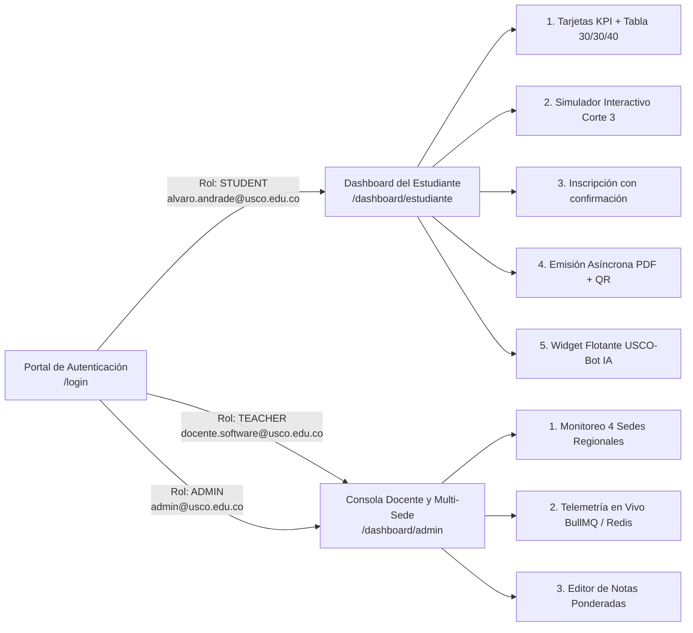

# 06. Manual Oficial de Usuario por Roles (Estudiante, Docente y Administrador Multi-Sede)

**Plataforma:** EduDistribuida (USCO-Net) — Portal Académico Descentralizado Multi-Sede  
**Institución:** Universidad Surcolombiana (USCO) — Periodo Académico Activo `2026-2`  
**URL de Acceso Local:** `http://localhost:4321/login`

---

## 1. Introducción y Mapa de Navegación por Roles

**EduDistribuida (USCO-Net)** proporciona una interfaz institucional unificada con los colores oficiales de la Universidad Surcolombiana (**Vinotinto `#8F141B`** y **Dorado `#D4AF37`**), diseñada bajo estándares de accesibilidad **WCAG 2.1 AA** y arquitectura de **Islas Interactivas React 18 sobre Astro 5 SSR**.

### 1.1. Credenciales Institucionales de Acceso Rápido (1 Clic)

En la pantalla de inicio de sesión (`/login`), el usuario dispone del **Selector Rápido de Cuentas Demo (1 Clic)** que autocompleta automáticamente las credenciales:

| Perfil Institucional | Correo Electrónico | Contraseña | Sede Asignada | Ruta de Destino |
| :--- | :--- | :---: | :---: | :--- |
| **Estudiante Ingeniería de Software** | `alvaro.andrade@usco.edu.co` | `Usco2026*` | Sede Central Neiva (`NEI`) | `/dashboard/estudiante` |
| **Docente Ingeniería de Software** | `docente.software@usco.edu.co` | `Usco2026*` | Grupos de Neiva (`NEI`) | `/dashboard/admin` |
| **Docente regional** | `docente.regional@usco.edu.co` | `Usco2026*` | Grupos de Pitalito, Garzón y La Plata | `/dashboard/admin` |
| **Administrador General Multi-Sede** | `admin@usco.edu.co` | `Usco2026*` | Global 4 Sedes (`NEI`, `PIT`, `GAR`, `LPL`) | `/dashboard/admin` |

---

## 2. Guía Paso a Paso para el Rol Estudiante (`alvaro.andrade@usco.edu.co`)

### Paso 2.1. Inicio de Sesión en 1 Clic y Verificación del Clúster
1. Ingrese a `http://localhost:4321/login`.
2. En el panel derecho observará el **Estado en Vivo de los Microservicios** (`Core Academic API :4001`, `Worker BullMQ + PDF :4002` y `Chatbot IA Híbrido :4003`) junto con los 4 Nodos Regionales USCO (`NEI`, `PIT`, `GAR`, `LPL`).
3. Haga clic sobre la tarjeta **"Estudiante Ingeniería de Software — Sede Neiva (Álvaro Javier Andrade · Cód. 20221203806)"** (`data-testid="demo-student-btn"`).
4. Presione el botón **"Ingresar al Sistema Académico Distribuido"** (`data-testid="login-submit"`). El sistema validará la firma criptográfica JWT y lo redirigirá a `/dashboard/estudiante`.

### Paso 2.2. Interpretación de Indicadores KPI y Tabla de Calificaciones (30% / 30% / 40%)
En la franja superior del Dashboard Estudiantil encontrará **4 tarjetas KPI en tiempo real**:
- **Promedio General (PGA):** Muestra el promedio ponderado por créditos (`4.52 / 5.00`) calculado bajo la regla oficial USCO.
- **Créditos Inscritos (2026-2):** Indica el total de créditos y cursos activos (`13 Créditos (4 Cursos)`) frente al tope semestral de 21 créditos.
- **Sede Actual:** Confirma el nodo regional activo bajo protección Row-Level Security (`Neiva - NEI`).
- **Estado Financiero:** Certifica que la matrícula se encuentra `MATRÍCULA PAGADA` (Paz y Salvo verificado).

Debajo se presenta el **Registro Oficial de Calificaciones Ponderadas (Periodo 2026-2)** con las 4 asignaturas inicialmente inscritas:

| Código | Asignatura | Créditos | Corte 1 (30%) | Corte 2 (30%) | Corte 3 (40%) | Definitiva | Estado Académico |
| :---: | :--- | :---: | :---: | :---: | :---: | :---: | :--- |
| `ISW-401` | Ingeniería de Software II | 3 | `4.6` | `4.8` | `4.7` | **4.70** | `APROBADA` |
| `ISW-402` | Sistemas Distribuidos | 3 | `4.5` | `4.4` | `4.6` | **4.51** | `APROBADA` |
| `ISW-403` | Mantenimiento y Pruebas de Software | 3 | `4.2` | `4.0` | *Pendiente* | **2.46** *(Acum.)* | `Falta 1.35 en C3` |
| `ISW-304` | Bases de Datos II | 4 | `4.7` | `4.5` | `4.8` | **4.68** | `APROBADA` |

### Paso 2.3. Uso del Simulador Interactivo "¿Cuánto necesito sacar en el Corte 3?"
Justo debajo de la tabla de calificaciones se ubica la tarjeta del **Simulador Académico Interactivo en Tiempo Real**:
1. Seleccione la asignatura en el menú desplegable **Materia** (por defecto selecciona automáticamente `ISW-403 — Mantenimiento y Pruebas de Software`, que tiene el Corte 3 pendiente).
2. Deslice la barra interactiva o escriba una nota hipotética entre `0.0` y `5.0` en el campo numérico (por ejemplo, `4.5`).
3. El simulador aplica instantáneamente la fórmula reglamentaria:
   $$\text{Definitiva} = (\text{Corte}_1 \times 0.30) + (\text{Corte}_2 \times 0.30) + (\text{Corte}_3 \times 0.40)$$
4. El panel derecho mostrará la **Definitiva Proyectada** (`4.26`) y la **Nota mínima requerida en el Corte 3 para cerrar en 3.00** (`1.35`).

### Paso 2.4. Inscripción de asignaturas (con confirmación)
En la sección **Inscripción de asignaturas**:
1. Arriba a la derecha verá **"Te quedan N créditos"** (tope reglamentario: 21 por periodo). Las asignaturas disponibles aparecen primero; las ya inscritas, al final con la insignia **Inscrita**.
2. Pulse **"Inscribir ISW-405"**. El botón se convierte en **"Confirmar · 3 créditos"** y **"Cancelar"**: nada se registra hasta que confirme.
3. Al confirmar, el Core valida en una transacción que haya cupo, que no esté inscrito ya en la asignatura y que no supere el tope de créditos.
4. Si todo es correcto verá un mensaje verde, la barra de cupos actualizada y la asignatura en su tabla de calificaciones. Si el sistema lo rechaza (cupo agotado, tope de créditos), verá un mensaje rojo con el motivo exacto: **la inscripción no queda registrada**.
5. Si una asignatura supera los créditos que le quedan, su botón aparece deshabilitado con el texto **"Supera tu tope de créditos"**.

### Paso 2.5. Expedición Asíncrona de Certificados Académicos en PDF (BullMQ + QR + SHA-256)
En la sección inferior derecha (**Emisión Asíncrona de Certificados PDF**):
1. Elija el tipo de documento en el selector:
   - *Certificado de Estudio Oficial (Matrícula Activa 2026-2)*
   - *Boletín Completo de Calificaciones Ponderadas (30/30/40)*
   - *Certificado de Paz y Salvo Académico y Financiero*
2. Haga clic en **"Generar Certificado Oficial en PDF (HTTP 202 Accepted)"**.
3. Observará en vivo la barra de progreso pasando por las 3 etapas de la cola distribuida `BullMQ`:
   - `1. QUEUED (202)` → `2. PROCESSING` → `3. COMPLETED`.
4. Al completarse (en menos de 2 segundos), aparecerá el **Código de Verificación Único** (ej. `USCO-2026-8841`), el hash criptográfico `SHA-256` y el botón verde **"Descargar PDF Oficial con QR y Hash SHA-256"**.

### Paso 2.6. Menú de Cuenta, Modo Claro/Oscuro, Tablas Compactas y Experiencia Móvil
En la esquina superior derecha de la barra institucional se encuentra el **Menú de Cuenta y Apariencia** (`UserProfileMenuIsland`):
1. **Conmutador rápido de tema:** El botón de sol/luna permite alternar instantáneamente entre el **Modo Oscuro Institucional** y el **Modo Claro de Alto Contraste** (preferencia persistida en `localStorage`).
2. **Popover de Perfil:** Al hacer clic en el avatar con indicador en línea, se despliega el menú con el rol del usuario, el nombre completo de su sede asignada (`Sede Central Neiva`, `Sede Pitalito`, etc.), accesos directos exclusivos de su rol, **Mi perfil**, **Apariencia** (incluyendo el interruptor de **Tablas compactas**) y **Cerrar sesión**.
3. **Diseño 100% Responsive:** En dispositivos móviles (`< 768 px`), las tablas de calificaciones y la planilla docente cambian automáticamente a **Vista de Tarjetas** y el botón flotante del asistente se adapta a un ícono compacto.

### Paso 2.7. Uso del Asistente Académico
El botón flotante **"Asistente Académico"** aparece en la esquina inferior derecha del panel del estudiante (solo para estudiantes con sesión iniciada; responde siempre sobre su propio expediente):
1. Haga clic en el botón flotante para desplegar la ventana conversacional (y vuelva a pulsarlo para cerrarla).
2. En la cabecera puede elegir el **Tipo de respuesta** (`Recomendado`, `Conversacional`, `Respuesta rápida` o `Conversacional alternativo`) o reiniciar la conversación con el botón de recarga.
3. Puede utilizar los botones de **Consultas frecuentes** o escribir en lenguaje natural:
   - *"Ver mis notas y promedio"* → Renderiza una tabla incrustada dentro del chat con las notas de cada corte y el PGA actual.
   - *"¿Cuánto necesito en el Corte 3?"* → Calcula exactamente cuánto necesita en las asignaturas con el tercer corte pendiente.
   - *"Generar certificado de estudio en PDF"* → Invoca la expedición asíncrona y entrega una tarjeta descargable con el PDF firmado y su código QR.

---

## 3. Guía paso a paso para el rol Docente

1. En `/login`, seleccione la tarjeta **Docente** (o escriba `docente.regional@usco.edu.co` para la docente de las sedes regionales) y presione **Ingresar**.
2. Llegará a **Mis grupos y calificaciones**. Arriba verá cuatro indicadores de *sus* grupos: grupos a cargo, estudiantes, cortes 3 por registrar y promedio de las definitivas. Solo aparecen los estudiantes de los grupos que usted dicta, en cualquier sede.
3. En la **Planilla de notas**:
   - Busque al estudiante o la asignatura con el buscador.
   - Escriba la nota del corte (0.0 a 5.0). La fila se marca en ámbar y aparece el aviso **"1 fila con cambios sin guardar"**; la definitiva se recalcula al instante.
   - Pulse **Guardar** en esa fila. Al confirmarse, el botón cambia a **Guardado** y verá un mensaje verde. Si el servidor rechaza el cambio, verá el motivo en rojo y la fila seguirá marcada como pendiente.
   - Si intenta cerrar o recargar la página con filas sin guardar, el navegador le pedirá confirmación.
4. Cada nota guardada (`PUT /api/v1/grades`) publica un evento en la cola de notificaciones para avisar al estudiante.

---

## 4. Guía Paso a Paso para el Rol Administrador Multi-Sede (`admin@usco.edu.co`)

1. En `/login`, seleccione la tarjeta **"Administrador General Multi-Sede (Dra. María Fernanda Perdomo)"** y presione **Ingresar**.
2. En el panel `/dashboard/admin` tendrá acceso completo a las **3 consolas de gobierno distribuido**:
   - **Consolidado Multi-Sede Universidad Surcolombiana (4 Nodos Regionales):** Visualiza tarjetas interactivas para **Neiva (`NEI`)**, **Pitalito (`PIT`)**, **Garzón (`GAR`)** y **La Plata (`LPL`)** con el conteo de estudiantes, secciones abiertas y promedio académico por sede. Al hacer clic en cualquier tarjeta de sede, la tabla inferior se filtra instantáneamente para mostrar únicamente las matrículas de esa sede regional.
   - **Solicitudes de certificados y notificaciones:** contadores en vivo (cada 5 segundos) de trabajos en espera, en curso, expedidos y fallidos. El indicador de estado es verde (**Al día**), ámbar (**Cola sin Redis**, modo respaldo) o rojo (**Servicio de certificados sin respuesta**).
   - **Editor Global de Calificaciones Multi-Sede:** Permite auditar y modificar calificaciones de cualquiera de las 4 sedes universitarias con trazabilidad completa.
